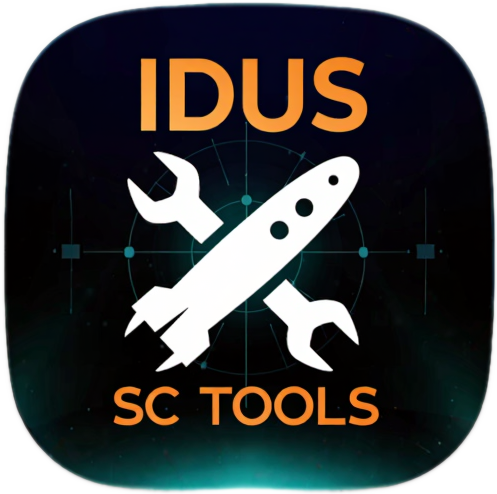

<div align="center">



# Idus SC Toolbox

**One-click fixes for running Star Citizen on Linux.**

A small GTK4 companion to the [LUG Helper](https://github.com/starcitizen-lug/lug-helper)
that handles the chores you otherwise redo by hand after every patch — killing a hung
client, backing up and restoring your keybinds, diagnosing HOTAS trouble, pinning the
launcher and game to the right screen, clearing the shader cache, and updating
[StarStrings](https://github.com/MrKraken/StarStrings).


</div>

<!-- Add a screenshot here once you have one:

-->

## Why

Star Citizen on Linux runs great via Wine/LUG — but each patch brings the same little
rituals: a client that won't die, keybinds that scramble when a joystick re-enumerates,
the launcher opening on the wrong monitor, stale shaders causing stutter. Idus SC Toolbox
puts all of those one click away, and keeps a backup so you can roll back when something
breaks mid-session.

## Requirements

- KDE Plasma 6 (Wayland or X11)
- Python + GTK4 bindings: `sudo pacman -S --needed python-gobject gtk4`
- A LUG-Helper install of Star Citizen (the Wine prefix is auto-detected from its config)
- Fonts [Saira](https://fonts.google.com/specimen/Saira), [IBM Plex Sans](https://fonts.google.com/specimen/IBM+Plex+Sans)
  and [JetBrains Mono](https://fonts.google.com/specimen/JetBrains+Mono). The installer downloads any that are
  missing to `~/.local/share/fonts/idus` (no sudo). Without them the app uses system fonts.

## Install

Download the three files (or grab them from [Releases](../../releases)), put them in one
folder, then run:

```bash
bash install-idus-sc-toolbox.sh
```

- The Wine **prefix is auto-detected** from `~/.config/starcitizen-lug/`.
  Wrong guess? Run: `SC_PREFIX=/your/path bash install-idus-sc-toolbox.sh`
- Backups default to `~/SC-backups`. Change with
  `SC_BACKUP_DIR="/path" bash install-idus-sc-toolbox.sh`
- Launch from the menu ("Idus SC Toolbox") or the terminal (`idus-sc-toolbox`).
- New icon not showing? Log out/in — the KDE icon cache is stubborn.

## What the buttons do

The window has two columns: groups 1–3 on the left, 4–7 and the log on the right. Above them sit
the **▶ Launch** button and the **Status** panel.

### ▶ Launch (top right)

The everyday way to start the game. It asks RSI which RSI Launcher version is current (the
public `latest.yml` that [LUG Helper](https://github.com/starcitizen-lug/lug-helper) also
installs from) and compares it with the version in your Wine prefix.

- Up to date → starts the launcher on your play runner, like **Restart launcher**.
- Newer launcher out → asks first: **🩹 Patch mode** (default), **Launch anyway** or **Cancel**.
  The launcher updates itself on start, and that is safer on the patch runner.
- Offline → starts normally and says so in the log.
- While the launcher runs, the Toolbox follows its log. If the launcher starts patching the
  game on the play runner, or loops with `did not converge`, it offers to switch to patch mode.

CIG has no public source for the next *game* version, so game patches are caught when the
launcher starts them, not before.

### Status panel

| Tile | Shows |
|---|---|
| Play runner | Runner from `sc-launch.sh`, plus locale / XIM input (the åäö fix) |
| Patch runner | Runner used by Patch / verify, or "not set up" |
| Wineserver now | Which runner's wineserver is running. Two servers or an unknown Wine → warning |
| Game | Version and build from `build_manifest.id` for the selected environment |
| RSI Launcher | Installed version vs. RSI's latest |
| Launcher log | Last patch error in the RSI Launcher log, and whether the game was updated after it |
| Disk | Free space on the prefix disk, with a bar. Yellow under 50 GB |
| Audio · PipeWire | Whether `clock.force-quantum` is forced (the 2048 button then gets an orange frame) |

The panel refreshes after every action and with **⟳ Refresh**.

### Buttons

| Group | Button | Action |
|---|---|---|
| Close / clean | Kill SC + launcher + wineserver | `pkill` the game/launcher, then `wineserver -k` with every runner `sc-launch.sh` points at |
| | Restart launcher | Kill everything, then run LUG's `sc-launch.sh` |
| | Patch / verify launcher | Kill everything, then run `sc-launch.sh patch` — the RSI Launcher on a separate PATCH runner, for game updates and Verify. Needs [patch mode](#patch-mode-two-runners) in `sc-launch.sh`; refuses to start otherwise |
| Config in Kate | USER.cfg / attributes.xml / actionmaps.xml / sc-launch.sh | Opens the file in Kate |
| | Game.log (follow live) | `tail -F` in Konsole |
| | Launcher log (follow live) | The RSI Launcher `log.log` in Konsole — updates, Verify and patcher errors |
| | Game folder in Dolphin | Opens the env folder |
| Backup | Back up now | Tars `user/` (keybinds, attributes), USER.cfg, sc-launch.sh → `~/SC-backups`. The group shows when the last backup was taken |
| | Restore latest backup | Safety-copies current state, then unpacks the latest backup |
| | Auto-backup on launch | Takes one backup per day when the app starts |
| Joystick & windows | Joystick diagnostics | Lists devices, flags duplicate instances, shows what SC expects |
| | Fix windows now | One-shot: centre launcher + SC to main screen (KWin) |
| | Always on main screen | Installs a small KWin script: the launcher and SC open on the main screen every time (also with Wayland runners, wherever the mouse is). Switch off in System Settings → KWin Scripts or with `--kwin-remove` |
| | Main screen | Which screen counts as the main one. Default: the screen KDE calls primary. Screens are tracked by name (e.g. `HDMI-A-1`), because KWin's own numbering is neither left to right nor primary first |
| | Open Window Rules | Opens the KDE Window Rules settings |
| Shaders & audio | Clear shader cache | Deletes SC shader cache (optionally the GPU driver cache too) |
| | PipeWire quantum 2048 / Reset | Audio-stutter workaround |
| VRAM | Meter + VRAM check | Live bar in the group (used / total). The button opens the visual meter of GPU memory with a per-process bar chart; flags heavy apps (e.g. OrcaSlicer) to close before launching SC. **NVIDIA only** |
| StarStrings | Update StarStrings (LIVE) | Downloads the latest [StarStrings](https://github.com/MrKraken/StarStrings) LIVE release, backs up the old english `global.ini` → `global.ini.BAK-[date]`, installs the new one |

### CLI

Every action has a flag, for KDE global shortcuts or a Stream Deck:

```bash
idus-sc-toolbox --launch | --status | --kill | --restart | --restart-patch | --fix-windows \
                --backup | --restore | --diag | --starstrings | --vram | --kwin-rule | --kwin-remove \
                --shaders [--driver-cache] | --quantum on|off | --env PTU | --screen N
```

`--launch` does the same check as the ▶ button, without asking: a newer launcher starts in
patch mode. Right-clicking the Toolbox in the start menu offers **▶ Launch** and
**🩹 Patch / verify launcher** too, so you can use it as your Star Citizen shortcut.

## Patch mode (two runners)

Sometimes the Wine runner that plays best can't patch. Example from November 2026:
`lug-wine-tkg-staging-experimental-wayland-git-11.17-1` fixed clicking at in-game terminals,
but on it RSI Launcher 2.19.1 looped on Update/Verify with
`p4k verification did not converge after 10 passes`. On `lug-wine-tkg-staging-git-11.16-1`
the same update finished in about 30 seconds. Your runners may differ; the setup is the same.

The fix is to play on one runner and patch on another, without editing `sc-launch.sh` every
patch day. Add this to your `sc-launch.sh`, in the *Wine binary path* section, replacing the
existing `export wine_path=...` line and using your own runner folders:

```bash
# PLAY runner (default)
export wine_path="/path/to/runners/<play-runner>/bin"
# PATCH runner - used by "./sc-launch.sh patch"
patch_wine_path="/path/to/runners/<patch-runner>/bin"
play_wine_path="$wine_path"

if [ "$1" = "patch" ]; then
    export wine_path="$patch_wine_path"
fi
```

Then replace the `"$wine_path"/wineserver -k` line with these two lines. A wineserver can
only stop a server started by its own Wine version.

```bash
"$play_wine_path"/wineserver -k
"$patch_wine_path"/wineserver -k
```

On patch day, click **Patch / verify launcher**, let the launcher update or verify, then click
**Restart launcher** to play. Without patch mode in `sc-launch.sh`, the button logs a message
and starts nothing, so it never quietly patches on the wrong runner.

## Notes & caveats

- **Window rules are machine-specific** — screen index, which monitor is primary and the
  resolution differ per setup. The generated rules are a starting point; adjust the
  `Screen` number in Window Rules if a window lands on the wrong monitor.
- **StarStrings also needs `USER.cfg`** (`g_language`) in the game root to take effect.
  The tool backs up and replaces the english `global.ini` only; it does not touch USER.cfg.
- "Always on main screen" is a KWin script (`~/.local/share/kwin/scripts/idus-sc-toolbox-placement`), not a window rule. Installing it removes the old "SC Toolbox" window rules (backup: `kwinrulesrc.sctoolbox.bak`).
- **Hardware-specific features:** the VRAM check is **NVIDIA only** (reads `nvidia-smi`, any
  NVIDIA card), and the joystick diagnostics are tuned for **VIRPIL** HOTAS. Everything else
  is vendor-agnostic.
- Not affiliated with Cloud Imperium Games or the LUG. Use at your own risk — it ships a
  backup button for a reason. 🙂

## Uninstall

```bash
rm -f  ~/.local/bin/idus-sc-toolbox ~/.local/share/applications/idus-sc-toolbox.desktop
rm -rf ~/.local/share/idus-sc-toolbox ~/.local/share/icons/hicolor/512x512/apps/idus-sc-toolbox.png
rm -rf ~/.local/share/fonts/idus   # fonts the installer downloaded (skip if other Idus apps use them)
```

## Support

Made by **Idus**. If this saved you time and you want to sponsor a new citizen,
use my Star Citizen referral code when you enlist — you get 5,000 free aUEC to start:

**`STAR-2GDF-FDKH`**
→ https://www.robertsspaceindustries.com/enlist?referral=STAR-2GDF-FDKH

Or buy me a coffee:

<a href='https://ko-fi.com/N4N2QZHKK' target='_blank'></a>

## License

MIT — see [LICENSE](LICENSE).

o7
